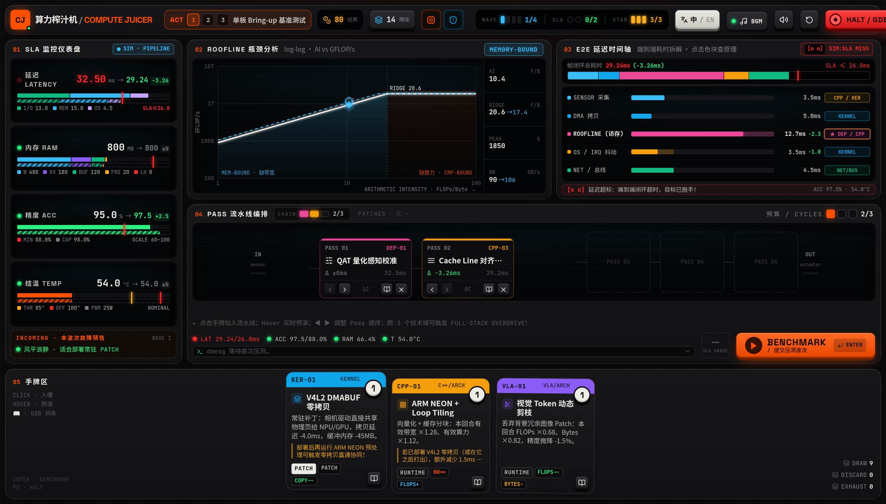
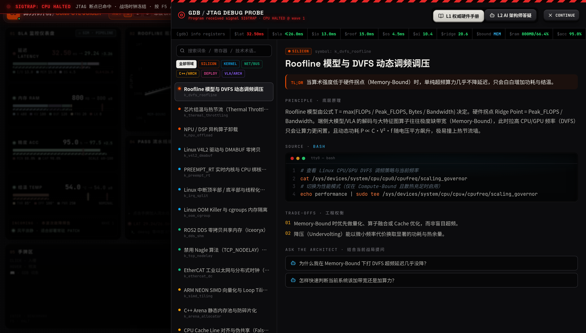

# 算力榨汁机 · Compute Juicer

> 一款开源、纯前端的硬核技术向卡牌构筑 Roguelike 网页游戏——**「机制即知识」**，拒绝套壳刷题。  
> An open-source, pure-frontend roguelike deckbuilder for edge AI, embedded systems, Linux kernel/drivers, C++ micro-architecture & VLA optimization.
>
> **在线试玩 (Play Online)**：https://fpip98.github.io/compute-juicer/



<details>
<summary>点击查看：按 <code>F5</code> 冻结战场呼出的 GDB / JTAG 硬件断点终端（44 篇离线手册 + AI 架构师答疑）</summary>



</details>

---

## 核心特色

- **真实物理公式驱动（SI 单位对齐）**：
  - 实时 **Roofline 屋顶线示波器** + **5 段 E2E 延迟火焰图**：在 `Memory-Bound` 下强行超频（DVFS）几乎不降延迟反而白白升温，必须先靠量化 / `FlashAttention` / Cache 优化突破拐点。
- **编译器 Pass 式流水线编排**：
  - 拖拽/重排每回合执行顺序，顺序即因果（如 `QAT` 必须排在 `INT4` 之前保护精度；`V4L2 DMABUF` 配合 `ARM NEON` 触发零拷贝协同；跨 **3 个以上技术域** 触发 **`FULL-STACK OVERDRIVE`** 爆发）。
- **全栈 6 层硬核知识覆盖**：
  - **52 张卡牌 · 12 件硬件遗物 · 11 种线上故障 · 3 幕 15 个关卡 · 6 个幽默研发事件**，横跨硅片硬件、Linux 内核驱动、嵌入式网络总线、C++ 微架构、端侧推理编译与 Transformer/VLA。
- **内置 `F5` GDB / JTAG 硬件断点终端**：
  - 随时按 `F5` 冻结战场时钟（Web Audio 背景配乐同步低通闷音），内置 **44 篇离线权威硬件手册与真实代码片段**；支持可选 BYOK（DeepSeek / OpenAI / 本地 Ollama）自动注入当前战局寄存器快照实时追问架构原理。
- **零外部美术与音频依赖**：
  - 纯 React + TypeScript + Tailwind CSS + Framer Motion + SVG + Web Audio API 生成式 BGM/音效，自动 `localStorage` 存档续玩，支持一键中英切换（专业术语保持英文）。

## 核心物理仿真模型

**1. 端到端推理闭环延迟（End-to-End Latency）**

$$
T_{\mathrm{total}} = T_{\mathrm{Sensor}} + T_{\mathrm{Copy}} + T_{\mathrm{Roofline}} + T_{\mathrm{OS/IRQ}} + T_{\mathrm{Net/Bus}}
$$

**2. Roofline 瓶颈与拐点判定**

$$
T_{\mathrm{Roofline}} = \max\left(\frac{\mathrm{FLOPs}}{\mathrm{Peak}_{\mathrm{eff}}},\; \frac{\mathrm{Bytes}}{\mathrm{BW}_{\mathrm{eff}}}\right), \qquad I_{\mathrm{AI}} = \frac{\mathrm{FLOPs}}{\mathrm{Bytes}}, \qquad I_{\mathrm{ridge}} = \frac{\mathrm{Peak}_{\mathrm{eff}}}{\mathrm{BW}_{\mathrm{eff}}}
$$

- 当 $I_{\mathrm{AI}} < I_{\mathrm{ridge}}$ 时为 **`MEMORY-BOUND`**（访存受限，优先做量化、算子融合、Cache/带宽优化）；
- 当 $I_{\mathrm{AI}} \ge I_{\mathrm{ridge}}$ 时为 **`COMPUTE-BOUND`**（算力受限，超频、NPU 卸载、剪枝与 SIMD 收益拉满）。

**3. 热力学与热节流（Thermal Throttling）**

$$
\Delta T = \alpha \cdot P_{\mathrm{active}} - \beta \cdot (T_{\mathrm{curr}} - T_{\mathrm{ambient}}) \cdot k_{\mathrm{cool}}
$$

- 结温达到阈值（默认 $85^\circ\mathrm{C}$）触发热节流，$\mathrm{Peak}_{\mathrm{eff}}$ 强制下降 $35\%$；达到 $100^\circ\mathrm{C}$ 触发硬件过热关机。

## 全栈 6 层知识域

| 层级 | 知识域 | 典型机制与卡牌 |
| :--- | :--- | :--- |
| **1** | `SILICON` 硅片与嵌入式硬件 | DVFS 调频、PWM 散热、NPU 卸载、SRAM 暂存区、Clock Gating、PCIe P2P |
| **2** | `KERNEL` Linux 内核与驱动 | V4L2 DMABUF 零拷贝、`PREEMPT_RT` + `isolcpus`、Threaded IRQ、2MB HugePages、DMA SG、RCU、cgroups/OOM |
| **3** | `NETWORK` 嵌入式网络与总线 | ROS2 Iceoryx 共享内存、`TCP_NODELAY`、EtherCAT DC、eBPF/XDP 内核旁路、CAN-FD 仲裁、TSN 802.1Qbv、UDP+FEC |
| **4** | `CPP` C++ 与微架构 | ARM NEON + Loop Tiling、Arena 内存池、Cache Line 对齐防伪共享、Lock-Free SPSC、`__builtin_prefetch`、Branchless、`std::span`、SoA |
| **5** | `DEPLOY` 端侧推理与编译 | QAT 校准、INT4 AWQ、INT8 SmoothQuant、FlashAttention 融合、TensorRT Graph Capture、Speculative Decoding、TVM 静态内存规划、LoRA 合并 |
| **6** | `VLA` 模型架构与具身智能 | 视觉 Token 剪枝、PagedAttention、GQA、MoE 稀疏路由、Action Chunking、快慢双系统（Sys1+Sys2）、Early-Exit、视触觉闭环 |

## 快速开始

```bash
git clone https://github.com/fPip98/compute-juicer.git
cd compute-juicer
npm install
npm run dev
```

常用快捷键：
- `Enter`：执行当前流水线 `BENCHMARK / COMMIT`（战后重开验收报告）
- `F5` / `Esc`：呼出 / 关闭 **GDB / JTAG 硬件断点终端**

## 接入实时 AI 架构师（可选）

按 `F5` 打开 GDB 终端 → 切到 **L2 AI 架构师答疑** → 点右上角设置：
- **DeepSeek**：Endpoint 填 `https://api.deepseek.com`，Model 填 `deepseek-chat`，填入 API Key。
- **本地 Ollama**：Endpoint 填 `http://localhost:11434`，Model 填本地模型名（需设置 `OLLAMA_ORIGINS=*` 允许浏览器跨域）。

> 所有配置仅保存在浏览器本地 `localStorage`，不会上传至任何第三方服务器。

## 开源部署与贡献

- Push 到 `main` 分支后，[.github/workflows/deploy.yml](.github/workflows/deploy.yml) 会自动运行 `npm test` + `npm run build` 并发布到 GitHub Pages。
- 想贡献新卡牌、线上故障或词条？请参阅 [CONTRIBUTING.md](./CONTRIBUTING.md) 与 [设计文档](./docs/DESIGN.md)。
